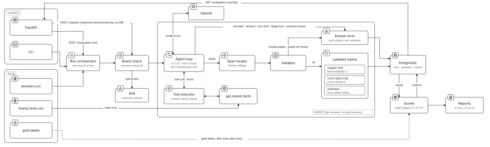
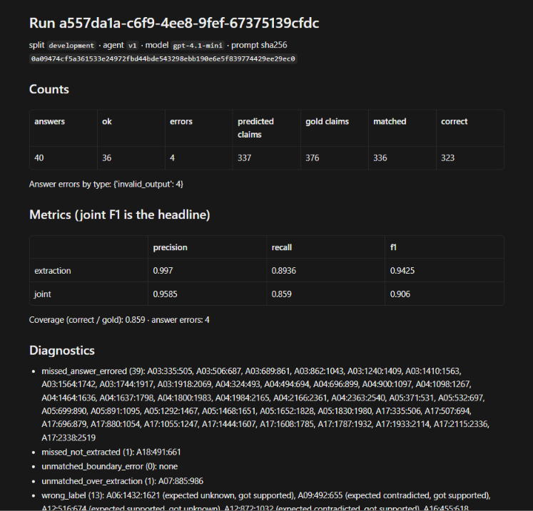
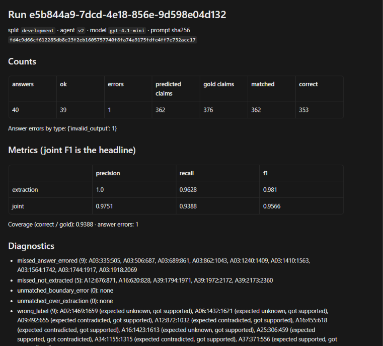
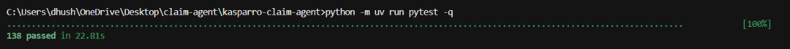

# ClaimLens

An AI agent that reads a long AI-written answer about speakers, finds every factual claim in it, and checks each one against a product catalogue. Each claim is marked **supported**, **contradicted** or **unknown**.

**[Jump to: How to run it](#how-to-run-it)**

---

## Architecture



## How it flows

1. An answer comes in, from the API or from a full dataset run.
2. I first check the brand is in the catalogue. If it isn't, I stop right there and the model is never called.
3. The agent sends the answer to OpenAI. The model asks for the brand's facts using the `get_brand_facts` tool, and my code checks that request before running it.
4. The model returns each claim sentence, broken into small parts, with each part marked as backed by a fact, refuted by a fact, or not in the facts.
5. Python finds the exact position of every sentence, checks everything, and works out the final label from those parts.
6. If anything goes wrong (bad output, timeout, too many turns), the whole answer is saved as an error. It never quietly becomes "unknown".
7. Results go into PostgreSQL. After that, the scorer compares them with the gold labels and writes the reports.

## Results

> Numbers below come from the real live runs saved in [`reports/`](reports/). Model `gpt-4.1-mini`, temperature 0, seed 7, 60 s timeout per request, no retries, at most 3 turns, 8192 output tokens.

| Dev split (40 answers, 376 gold claims) | v1 | v2 |
|---|---|---|
| Extraction F1 | 0.9425 | 0.9810 |
| **Joint F1** (main score) | 0.9060 | **0.9566** |
| Joint precision / recall | 0.9585 / 0.8590 | 0.9751 / 0.9388 |
| Answers with errors | 4 | 1 |

Check split (10 answers): quality metrics are not available because the check split has no gold labels. Both runs finished with all 10 answers ok and no errors. v1 accepted 94 claims and v2 accepted 93.

**v1 run**


**v2 run and comparison**


**Tests**


**What I changed in v2 and why:**

- **What v1 got wrong most.** 4 of the 40 answers were rejected whole, and they caused 39 of the 40 missed gold claims (10% of all gold). In three of them (A04, A05, A17) the model wrote the `occurrence` field as its running claim number (2, 3, 4 ... 11) instead of 1, which my validator rightly rejected. The v1 prompt said "then its 1-based position", and the model read that as the position in the claim list. The fourth (A03) wrote a reason longer than two sentences.
- **The one change.** v2 rewrites that single prompt line so it says `occurrence` is 1 for any sentence that appears once, and only counts copies of the same sentence when it repeats. Nothing else changed: same model, settings, validator, scorer and data. The `user.md` file is identical.
- **What improved.** Joint F1 went from 0.9060 to 0.9566. Answer errors fell from 4 to 1, and 36 claims were fixed, 30 of them from A04, A05 and A17.
- **What got worse.** 6 claims regressed. Four are "missing fact" sentences that v1 correctly marked unknown and v2 did not extract at all (A12, A16, A39 twice). Two flipped label: A02 from unknown to supported (a below-freezing scope case), and A25 from supported to contradicted, where the model's own reason contradicts itself. I did not measure run-to-run noise, so I can't say how much of these 6 comes from the prompt change.
- **Still open.** The A03 error (a three-sentence reason) is still there. I left it alone to keep v2 to one change.

All four runs: [v1 dev](reports/development-v1/report.md) · [v2 dev](reports/development-v2/report.md) · [v1 check](reports/check-v1/report.md) · [v2 check](reports/check-v2/report.md) · [comparison](reports/comparison-development.md) · [test output](reports/test_output.txt)

## Tech stack

| What | Used |
|---|---|
| Language | Python 3.12, managed with uv |
| API | FastAPI 0.142.1, Uvicorn 0.54.0 |
| Validation | Pydantic 2.13.5 |
| Database | PostgreSQL 16 (Docker), psycopg 3.3.6 |
| LLM | OpenAI SDK 3.22.0 (Chat Completions), tool calling with strict JSON output, model `gpt-4.1-mini` |
| Tests | pytest 9.1.1 with a fake model provider |

## API endpoints

| Endpoint | What it does |
|---|---|
| `POST /classify` | Checks one answer and returns its claims straight away. Nothing is saved. |
| `POST /evaluation-runs` | Runs the whole dev or check split, saves everything, and returns the run ID with counts and scores. It takes a few minutes because it runs inside the request. |
| `GET /evaluation-runs/{id}` | Returns a saved run with every answer and its claims, in order. |

Errors always come back in the same shape: `{"error": {"type": "...", "message": "..."}}`

| Status | When |
|---|---|
| 422 | bad request, or someone tries to send gold labels or claims in the input |
| 404 | unknown brand, or the run doesn't exist |
| 502 | the model failed or gave output that didn't pass the checks |
| 504 | the model took longer than 60 seconds |
| 503 | the database is down |
| 500 | anything unexpected (generic message, no stack trace), or a run that failed part way (the run ID is returned) |

## Database schema

**runs**: one row per run
`run_id`, `split`, `agent_version`, `status`, `config` (model, settings, versions, file hashes), `counts`, `metrics`

**answer_results**: one row per answer in a run
`run_id`, `answer_id`, `status` (ok or error), `error_type`, `error_message`, `claim_count`, `latency_ms`

**claim_results**: one row per accepted claim
`run_id`, `answer_id`, `claim_id`, `start_char`, `end_char`, `quote`, `label`, `fact_ids`, `reason`, `parts`, `match`

Every answer gets a row even if it failed or found nothing, so nothing goes missing quietly. The same span can't be saved twice in a run.

## How I understood the problem

When you ask an AI something, it gives you a confident answer, but some of it can be made up. The tricky part is it all reads the same, true or not. So the question is: **which sentences can I actually trust?**

Take answer A01 from the dataset, which is about the ClearTrail Mini for a weekend away. It has sentences like these (shortened where you see ...):

| Sentence from the AI answer | What the catalogue says | Result |
|---|---|---|
| "Start with the exact model name before deciding what belongs in a weekend bag." | It's just advice | skipped, not a claim |
| "...ClearTrail Mini costs INR 1,299 including tax but excluding shipping." | 2026 India list price is 1,299, tax included, shipping excluded | **supported** |
| "...ClearTrail Mini receives a standard manufacturer warranty lasting 18 months from the purchase date." | the matching India warranty is 12 months | **contradicted** |
| "The sustained amplifier output of ClearTrail Mini is forty watts per channel..." | no amplifier fact at all | **unknown** |

So I broke the problem into steps:

1. **Find the claims.** Pick out only the sentences that say something checkable. Skip advice, opinions and anything that looks like an instruction.
2. **Get the facts.** The model asks for the catalogue facts through a tool. It can't make them up or use outside knowledge.
3. **Check every part.** One sentence can say two things, like "18 month warranty **and** repairs in two days". I check each part on its own, so one wrong part isn't hidden by a right one.
4. **Decide the label.** If any part is wrong, it's contradicted. If nothing is wrong but something can't be confirmed, it's unknown. Only if every part checks out is it supported. This is plain aggregation of the model's own part checks, done in Python, not hardcoded labels.
5. **Don't trust the model blindly.** Python finds the exact positions, checks the output, and saves failures as errors instead of guessing.
6. **Measure it.** A scorer compares the saved results with the gold labels, matching spans exactly, so I know how well it really works.

## Tests

138 tests, all passing, none skipped. The full output is in [`reports/test_output.txt`](reports/test_output.txt).

| File | Tests | What it covers |
|---|---|---|
| `test_data.py` | 8 | CSV parsing (quoted commas, embedded newlines), strict booleans, 132 facts, 376 gold quotes equal their slice, hash check passes and fails on a modified copy |
| `test_agent.py` | 44 | the `get_brand_facts` tool and its errors, the 3-turn loop with a fake provider, every error kind, the gold-leak check over all 40 dev answers, the A07 injection answer passed through unchanged, placeholders never expanded, OpenAI error mapping, pinned prompt hashes |
| `test_spans.py` | 33 | label derivation, quote location, occurrence handling, validation rules, duplicates, overlaps, sorting |
| `test_harness.py` | 16 | the scorer (including G=10, P=10, M=8, C=7 giving 0.80 and 0.70), diagnostics, error answers, check split nulls, byte-identical re-scoring, compare |
| `test_api_db.py` | 37 | the three routes, the one error shape, 422/404/502/504/503/500, database constraints, a stored run read back in order, reports written by the runner |

Every test uses the fake provider, so none of them call OpenAI. The database tests need `make db` and skip with a clear message if PostgreSQL is not running (none were skipped in the final run).

## Honest notes

- I tested two answers (A01, A02) live before freezing v1. That smoke check first ran on `gpt-4.1-nano`, where both answers failed validation (a part with no fact id, and a repeated claim), so I switched to `gpt-4.1`, which passed. All four official runs then used `gpt-4.1-mini`. I did not change the v1 prompt because of the smoke check.
- I also tried `gpt-6-luna` on A01 and A02. It rejects function tools on Chat Completions unless `reasoning_effort` is `none`, so both answers failed before any output. I dropped it rather than change the pinned request settings. Those scratch runs are in the database but not in `reports/`.
- v2 was designed from the v1 development errors, so the development numbers are a design-time measurement, not a blind one.
- The check answers (A41 to A50) weren't used to tune anything, but the inputs were visible, so this isn't a fully blind test.
- Temperature is 0, but OpenAI results can still vary a little between runs. I did not run the optional repeat of v1 to measure that, so the gain from v1 to v2 comes from a single run of each.
- The v1 dev run was made right after commit 3, yet its saved config says the working tree was dirty. I did not find the reason. The v2 and check runs ran before commit 4 exists, so their config shows commit 3's hash with a dirty tree. Their prompt hashes match the committed prompt files: v1 `0a09474c…`, v2 `fd4c9d66…`.
- Setup differences on my machine: PostgreSQL is exposed on host port 5433 because 5432 was taken (the compose file defaults to 5432), and `.gitattributes` keeps the CSV files byte-exact on Windows.
- Limitations and unfinished work:
  - One answer (A03) still fails whole because of a reason longer than two sentences, so about 9 gold claims are lost.
  - In the v2 dev run 9 claims still have a wrong label and 5 were not extracted. The wrong labels are mostly arithmetic, unit conversion and condition scope.
  - Quality on the check split cannot be scored here because there is no gold for it.
  - `POST /evaluation-runs` runs inside the request and takes about 6 minutes for 40 answers. There are no background workers and no authentication on the API.
  - Everything was run on one model.
- Time spent: about 2 hours in total. About 1 hour on research and designing the architecture, then about 1 hour implementing it with AI help.
- AI assistance: I did the research and the architecture design first, then built the project with Claude Code (an AI coding assistant) following my written instructions. The assistant wrote the code, the tests, the v2 prompt line, the report files and the first draft of this README, ran the commands, and read the v1 errors to find the one v2 change. I supplied the dataset, the instructions and the OpenAI key, approved each live run, chose and changed the model, decided to drop `gpt-6-luna`, supplied the architecture diagram, ran the test suite and took the screenshots. The numbers in this file come from the real runs saved in `reports/`, produced by the code and not typed in by hand. This section was drafted by the assistant from the session record and filled in at my request.

## How to run it

**You need:** Python 3.12, [uv](https://docs.astral.sh/uv/), Docker, and an OpenAI API key.

**1. Get the code and install**
```bash
git clone https://github.com/Dhushyanthc/kasparro-claim-agent.git
cd kasparro-claim-agent
uv sync
```

**2. Add your settings**
```bash
cp .env.example .env
```
Then open `.env` and fill in `OPENAI_API_KEY` and `OPENAI_MODEL`. The database URL is already set for Docker.

**3. Start the database and check the data files**
```bash
make db
sha256sum -c data/SHA256SUMS
```

**4. Run the tests**
```bash
make test
```

**5. Run the evaluations**
```bash
make run V=v1 S=development
make run V=v2 S=development
make compare A=<v1 run id> B=<v2 run id>
make run V=v1 S=check
make run V=v2 S=check
```

**6. Start the API**
```bash
make api
```
Then try it:
```bash
curl -X POST localhost:8000/classify -H "content-type: application/json" \
  -d '{"answer_id":"A01","brand_id":"cleartrail","question":"...","ai_answer":"...","agent_version":"v1"}'

curl -X POST localhost:8000/evaluation-runs -H "content-type: application/json" \
  -d '{"agent_version":"v1","split":"development"}'

curl localhost:8000/evaluation-runs/<run_id>
```
